# lmphysics

**Rigid-body physics (Project Chrono) in one executable, driven from lmscript.**

[](https://github.com/lmctl-ai/lmphysics/actions/workflows/ci.yml)
[](https://github.com/lmctl-ai/lmphysics/releases)
[](LICENSE)

### Stacks, collisions and contact

| 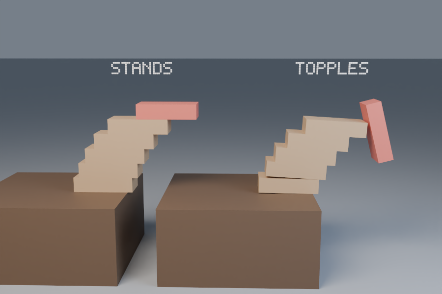 | 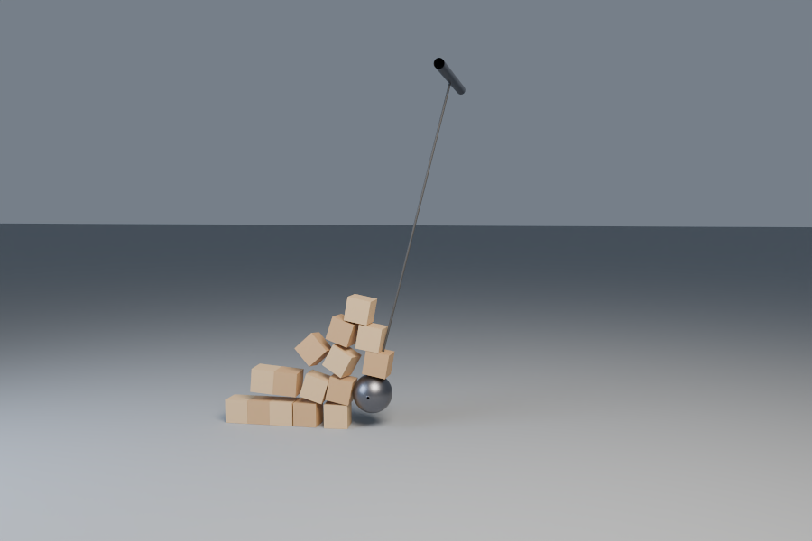 |
| --- | --- |
| Book-stacking puzzle: six blocks reach 1.225 block lengths past the edge; 10% further and the top one falls.<br>`lmctl https://raw.githubusercontent.com/lmctl-ai/lmphysics/main/examples/harmonic_overhang.lms` | A 400 kg wrecking ball hits a 15-crate pyramid at 6.26 m/s = sqrt(g L), as the energy says.<br>`lmctl https://raw.githubusercontent.com/lmctl-ai/lmphysics/main/examples/wrecking_ball.lms` |

| 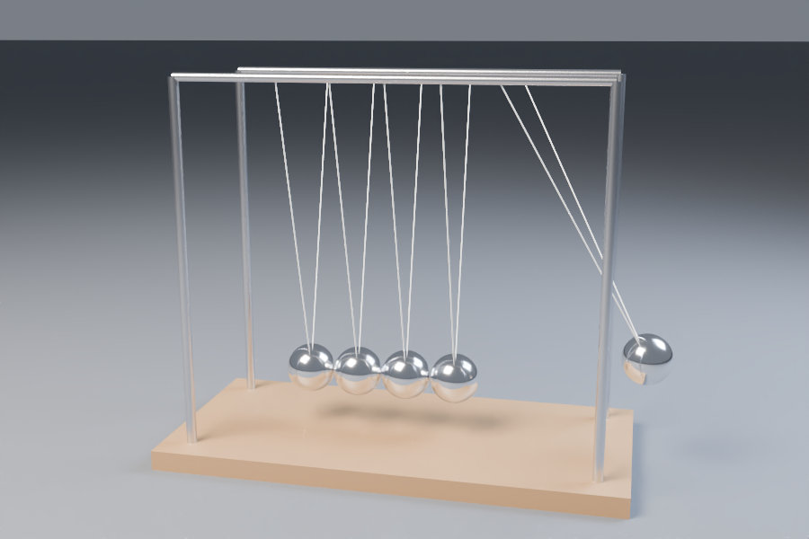 | 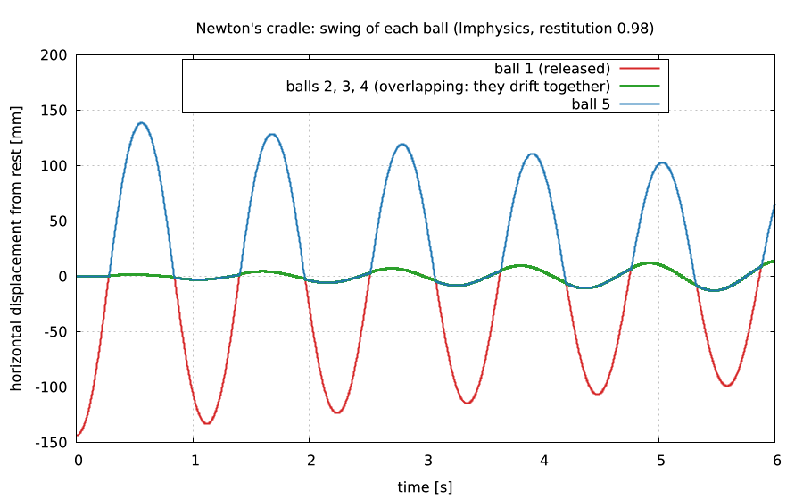 |
| --- | --- |
| Newton's cradle at the right ball's first apex (92% of the release height).<br>`lmctl https://raw.githubusercontent.com/lmctl-ai/lmphysics/main/examples/newtons_cradle.lms` | The same cradle over 6 s: with restitution 0.98 the middle balls slowly start to swing together.<br>`lmctl https://raw.githubusercontent.com/lmctl-ai/lmphysics/main/examples/newtons_cradle.lms` |

| 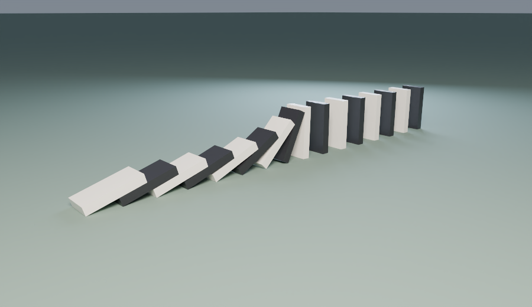 | 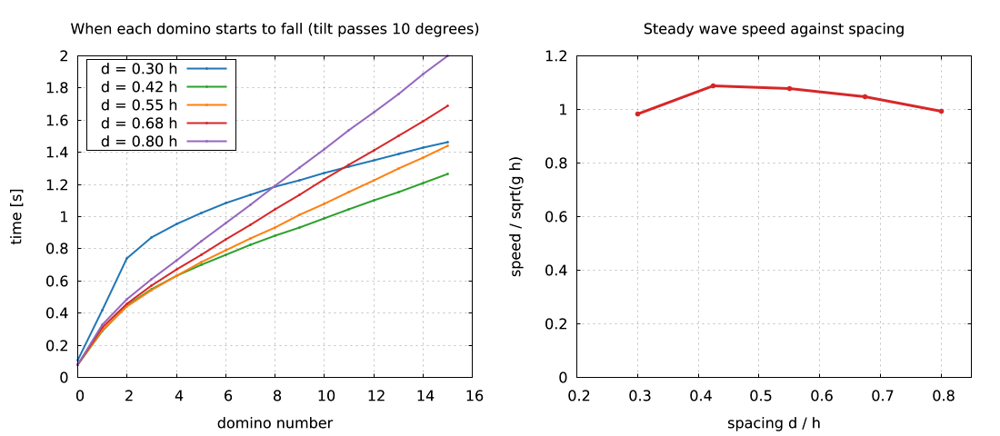 |
| --- | --- |
| A domino row mid-cascade, rendered from the simulated poses.<br>`lmctl https://raw.githubusercontent.com/lmctl-ai/lmphysics/main/examples/domino_cascade.lms` | The wave settles to about sqrt(g h); speed against spacing for five rows.<br>`lmctl https://raw.githubusercontent.com/lmctl-ai/lmphysics/main/examples/domino_cascade.lms` |

| 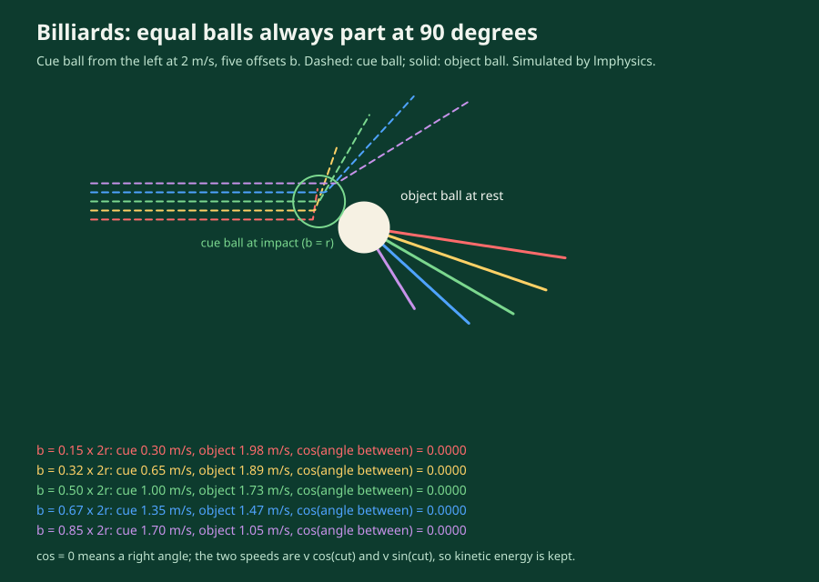 | 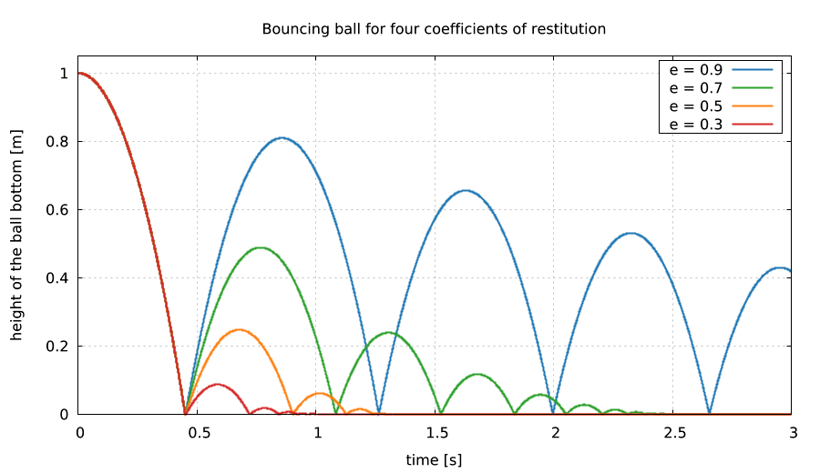 |
| --- | --- |
| Billiards: equal balls part at exactly 90 degrees for every cut (cos = 0.0000).<br>`lmctl https://raw.githubusercontent.com/lmctl-ai/lmphysics/main/examples/billiards_90.lms` | A ball dropped for four coefficients of restitution: each apex is e squared times the last.<br>`lmctl https://raw.githubusercontent.com/lmctl-ai/lmphysics/main/examples/viz_restitution.lms` |

| 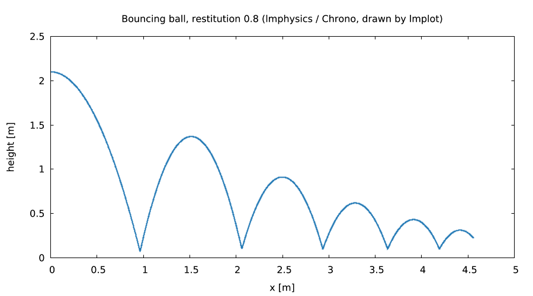 | 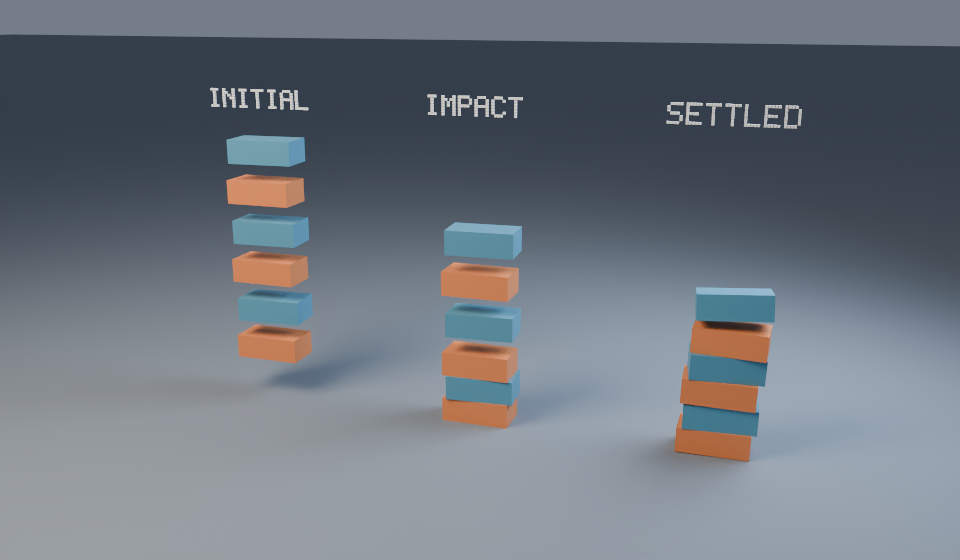 |
| --- | --- |
| A ball bouncing along the floor: lmphysics simulates, lmplot draws, one script.<br>`lmctl https://raw.githubusercontent.com/lmctl-ai/lmphysics/main/examples/combo/bounce_plot.lms` | Six falling bricks: initial, impact at 0.4 s, settled at 1.6 s.<br>`lmctl https://raw.githubusercontent.com/lmctl-ai/lmphysics/main/examples/blender_brick_stack.lms` |

| 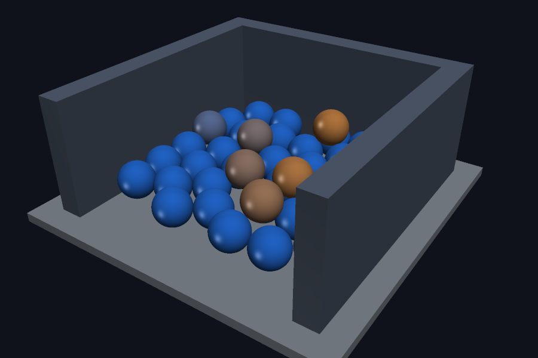 |  |
| --- | --- |
| Forty balls poured into a box and settled, rendered with lmcad.<br>`lmctl https://raw.githubusercontent.com/lmctl-ai/lmphysics/main/examples/viz_pour.lms` |  |


### Rolling, sliding and friction

| 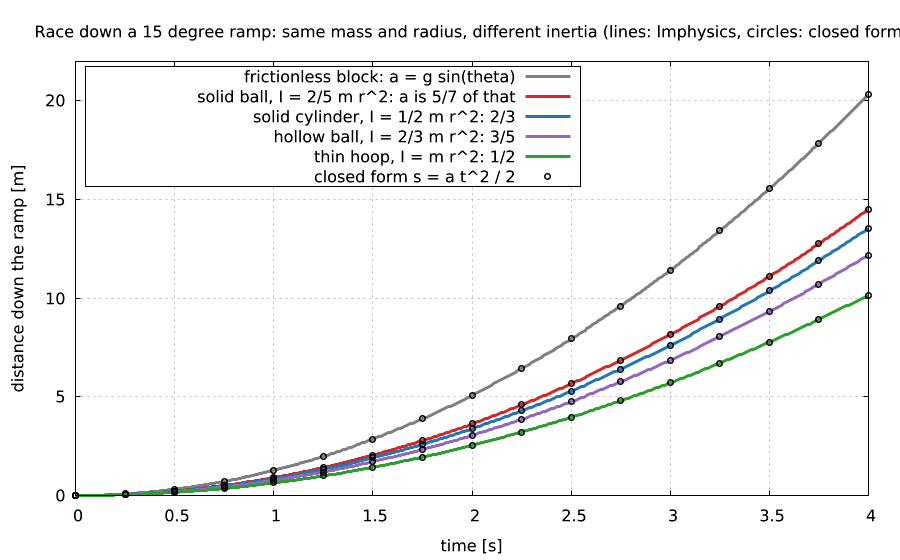 | 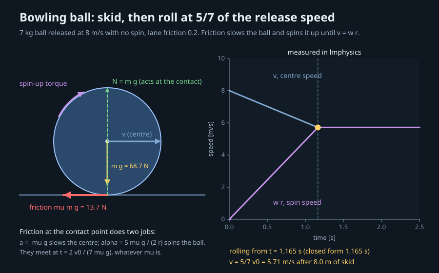 |
| --- | --- |
| Race down a ramp: a = g sin / (1 + I/m r^2) gives 5/7, 2/3, 3/5 and 1/2 of the sliding block.<br>`lmctl https://raw.githubusercontent.com/lmctl-ai/lmphysics/main/examples/rolling_race.lms` | Bowling ball: skids for 2 v0 / (7 mu g) = 1.165 s, then rolls at 5/7 v0; free-body diagram.<br>`lmctl https://raw.githubusercontent.com/lmctl-ai/lmphysics/main/examples/bowling_skid.lms` |

| 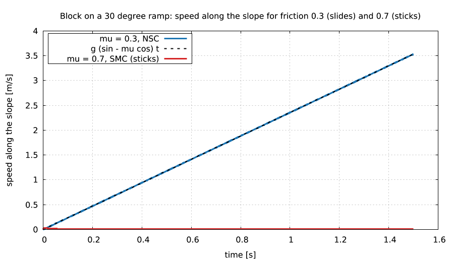 | 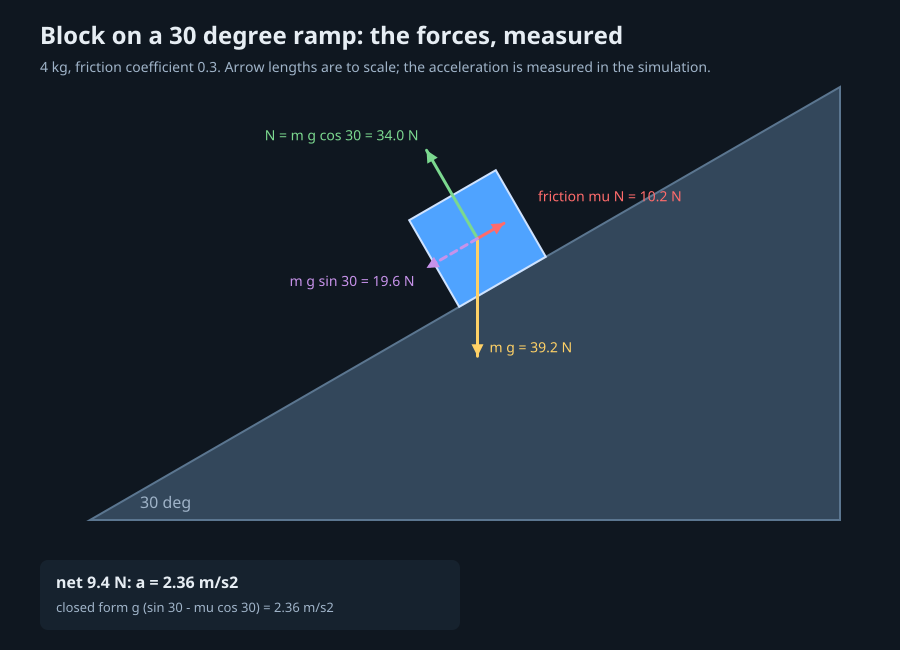 |
| --- | --- |
| A block on a 30 degree ramp: sliding at g (sin - mu cos), or sticking (NSC and SMC).<br>`lmctl https://raw.githubusercontent.com/lmctl-ai/lmphysics/main/examples/incline.lms` | Free-body diagram of the sliding block with the forces measured in the simulation (lmdraw).<br>`lmctl https://raw.githubusercontent.com/lmctl-ai/lmphysics/main/examples/viz_incline_forces.lms` |

| 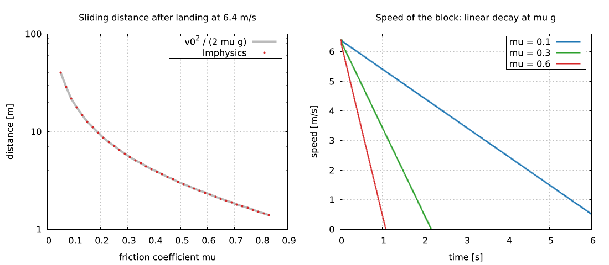 |  |
| --- | --- |
| Sliding distance against friction coefficient, 40 simulations on the closed form.<br>`lmctl https://raw.githubusercontent.com/lmctl-ai/lmphysics/main/examples/viz_friction_stop.lms` |  |


### Spinning bodies

| 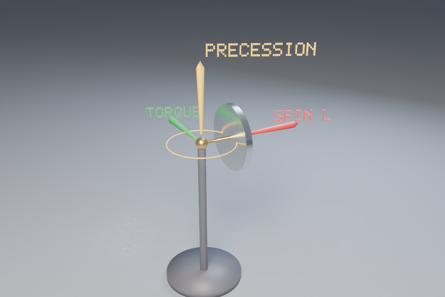 | 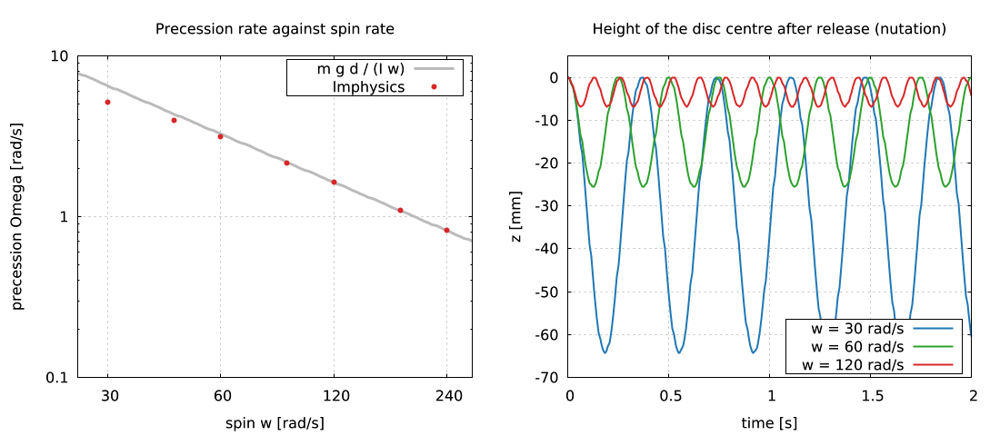 |
| --- | --- |
| Gyroscope: gravity's torque swings the spin sideways; the axle precesses instead of falling.<br>`lmctl https://raw.githubusercontent.com/lmctl-ai/lmphysics/main/examples/gyroscope.lms` | Precession rate against m g d / (I w) for seven spins, and the nutation dip shrinking as 1/w^2.<br>`lmctl https://raw.githubusercontent.com/lmctl-ai/lmphysics/main/examples/gyroscope.lms` |

| 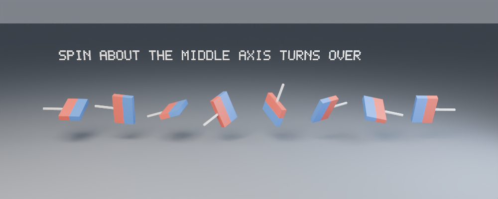 | 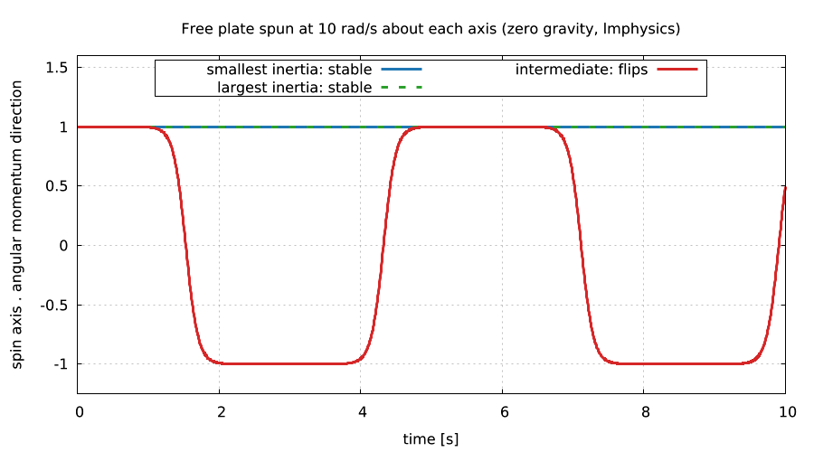 |
| --- | --- |
| Tennis-racket theorem: a spin about the middle axis turns over (white rod = spin axis).<br>`lmctl https://raw.githubusercontent.com/lmctl-ai/lmphysics/main/examples/tennis_racket.lms` | The same plate spun about each axis: only the intermediate one flips, every 2.8 s.<br>`lmctl https://raw.githubusercontent.com/lmctl-ai/lmphysics/main/examples/tennis_racket.lms` |


### Pendulums, chains and oscillators

| 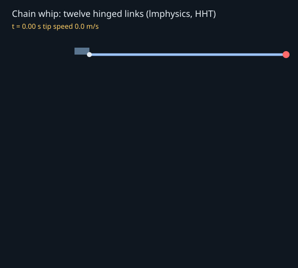 | 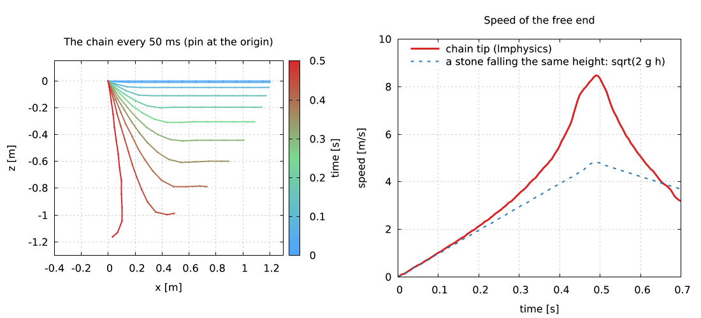 |
| --- | --- |
| Chain whip: twelve hinged links released horizontal (needs ffmpeg).<br>`lmctl https://raw.githubusercontent.com/lmctl-ai/lmphysics/main/examples/anim_chain_whip.lms` | The chain tip reaches 8.5 m/s, 1.7 times a stone falling the same height, with energy conserved.<br>`lmctl https://raw.githubusercontent.com/lmctl-ai/lmphysics/main/examples/chain_whip.lms` |

| 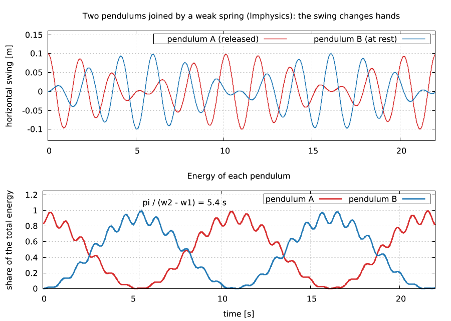 | 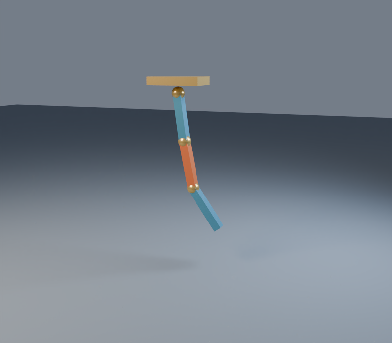 |
| --- | --- |
| Coupled pendulums: the swing changes hands every pi / (w2 - w1) = 5.4 s.<br>`lmctl https://raw.githubusercontent.com/lmctl-ai/lmphysics/main/examples/coupled_pendulums.lms` | Three linked pendulums at 0.55 s, with full simulated orientations (Cycles).<br>`lmctl https://raw.githubusercontent.com/lmctl-ai/lmphysics/main/examples/blender_pendulum_chain.lms` |

| 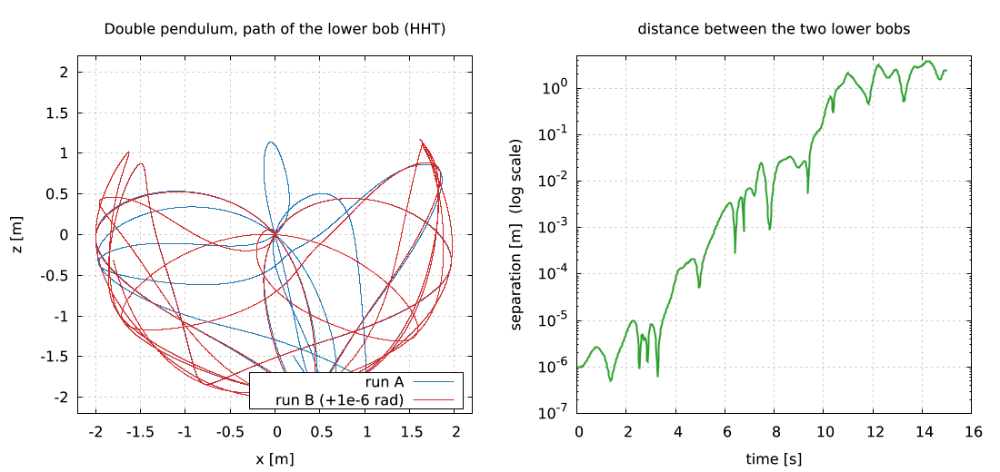 | 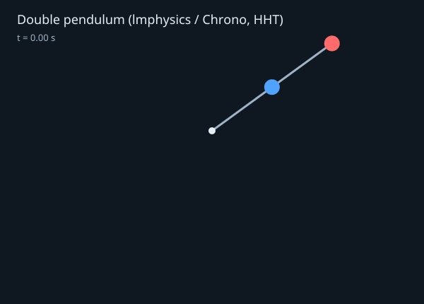 |
| --- | --- |
| Chaos: two double pendulums one micro-radian apart separate exponentially.<br>`lmctl https://raw.githubusercontent.com/lmctl-ai/lmphysics/main/examples/viz_double_pendulum.lms` | The same double pendulum, animated (needs ffmpeg).<br>`lmctl https://raw.githubusercontent.com/lmctl-ai/lmphysics/main/examples/anim_double_pendulum.lms` |

| 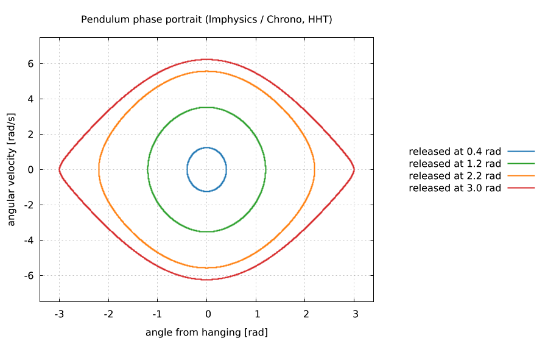 | 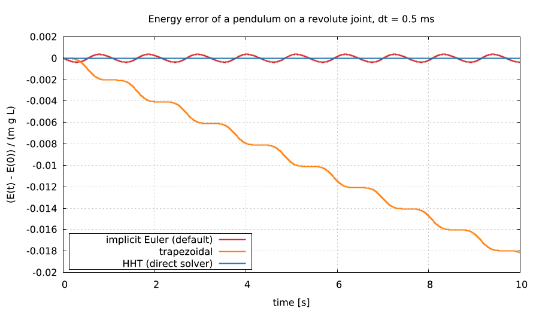 |
| --- | --- |
| Phase portrait of a pendulum on a joint: ellipses for small swings, the separatrix for large ones.<br>`lmctl https://raw.githubusercontent.com/lmctl-ai/lmphysics/main/examples/viz_pendulum_phase.lms` | Energy error of one pendulum under three Chrono integrators: HHT conserves it, trapezoidal bleeds it.<br>`lmctl https://raw.githubusercontent.com/lmctl-ai/lmphysics/main/examples/viz_energy_drift.lms` |

| 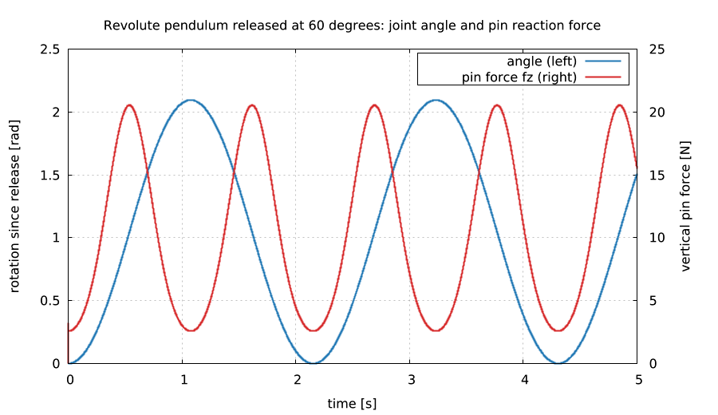 | 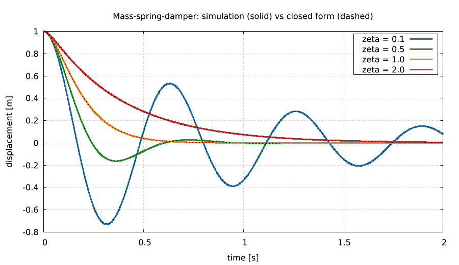 |
| --- | --- |
| Revolute pendulum: joint angle and the reaction force at the pin.<br>`lmctl https://raw.githubusercontent.com/lmctl-ai/lmphysics/main/examples/pendulum.lms` | Mass-spring-damper, four damping ratios, simulation on top of the closed form.<br>`lmctl https://raw.githubusercontent.com/lmctl-ai/lmphysics/main/examples/viz_damping.lms` |

| 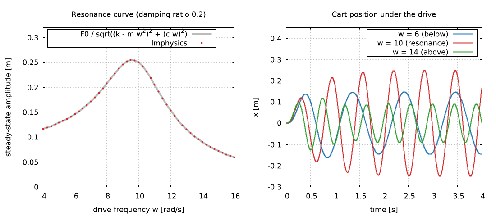 |  |
| --- | --- |
| Driven oscillator: simulated resonance curve and time histories (applied force).<br>`lmctl https://raw.githubusercontent.com/lmctl-ai/lmphysics/main/examples/viz_resonance.lms` |  |


### Mechanisms and machines

| 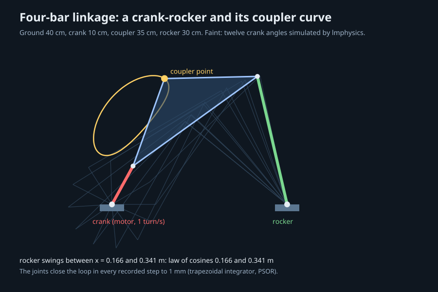 | 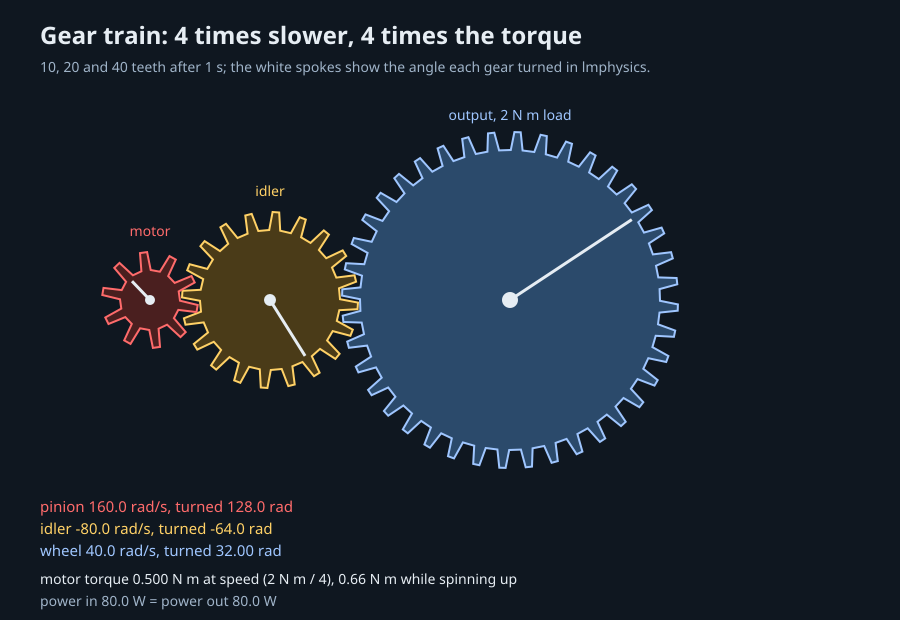 |
| --- | --- |
| Crank-rocker four-bar linkage and its coupler curve; rocker limits match the law of cosines.<br>`lmctl https://raw.githubusercontent.com/lmctl-ai/lmphysics/main/examples/four_bar_linkage.lms` | Gear train with an idler: 4 times slower, 4 times the torque, 80 W in = 80 W out.<br>`lmctl https://raw.githubusercontent.com/lmctl-ai/lmphysics/main/examples/gear_train.lms` |

| 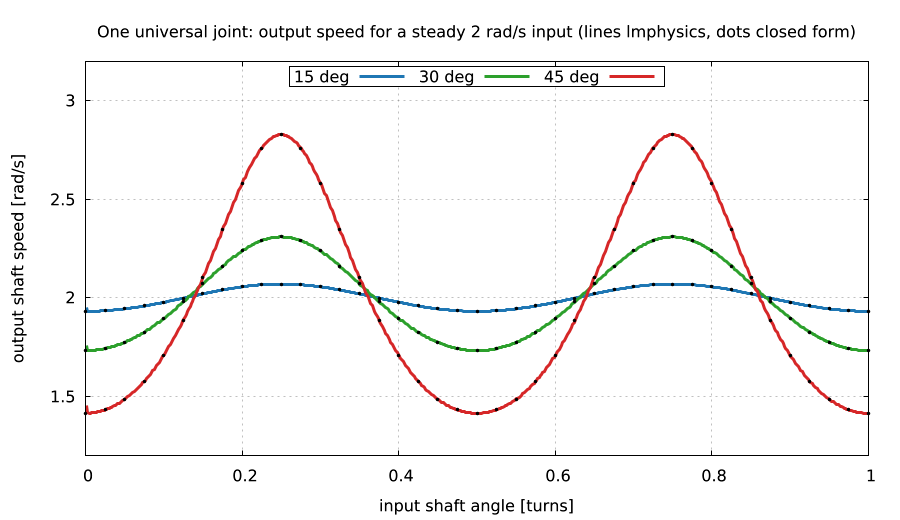 | 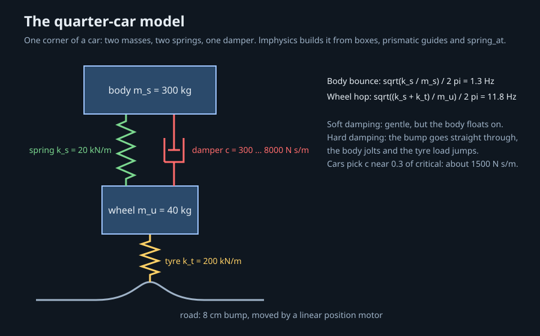 |
| --- | --- |
| One universal joint makes a steady shaft wobble between w cos b and w / cos b.<br>`lmctl https://raw.githubusercontent.com/lmctl-ai/lmphysics/main/examples/cardan_joint.lms` | The quarter-car suspension model (lmdraw).<br>`lmctl https://raw.githubusercontent.com/lmctl-ai/lmphysics/main/examples/quarter_car.lms` |

| 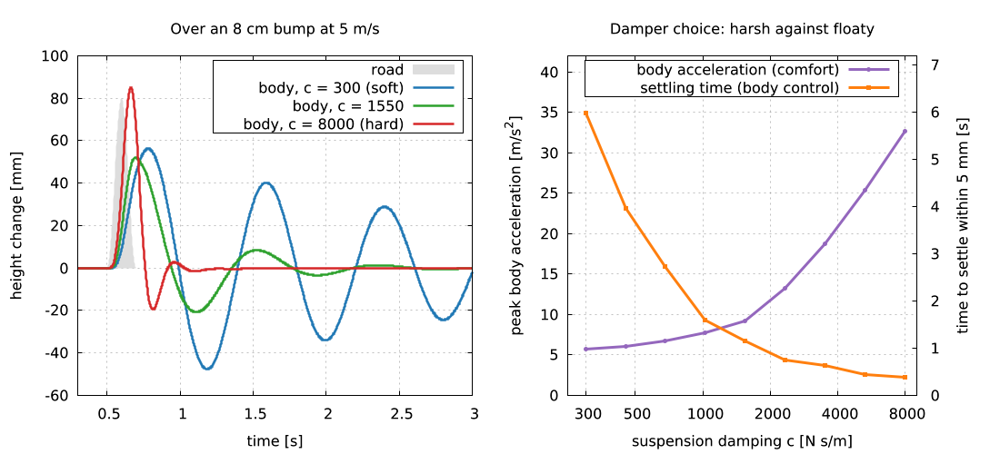 | 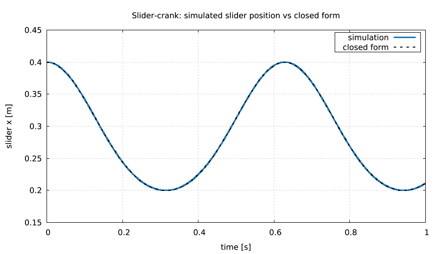 |
| --- | --- |
| Over a speed bump: soft damping floats, hard damping jolts; nine dampers swept.<br>`lmctl https://raw.githubusercontent.com/lmctl-ai/lmphysics/main/examples/quarter_car.lms` | Slider-crank driven by a motor: slider position against the closed form.<br>`lmctl https://raw.githubusercontent.com/lmctl-ai/lmphysics/main/examples/slider_crank.lms` |

| 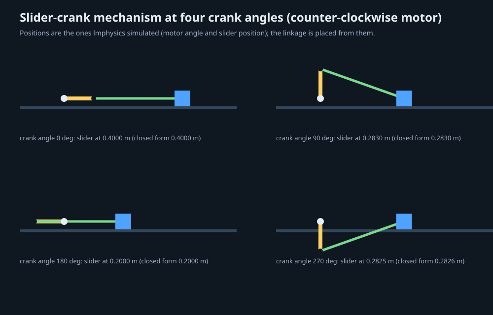 |  |
| --- | --- |
| The slider-crank drawn at four crank angles from the simulated positions.<br>`lmctl https://raw.githubusercontent.com/lmctl-ai/lmphysics/main/examples/viz_crank_snapshots.lms` |  |


### Projectiles

| 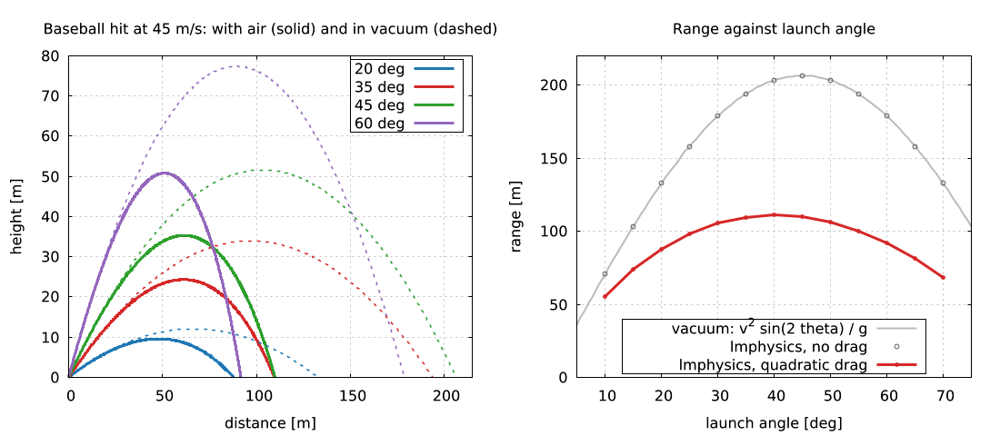 | 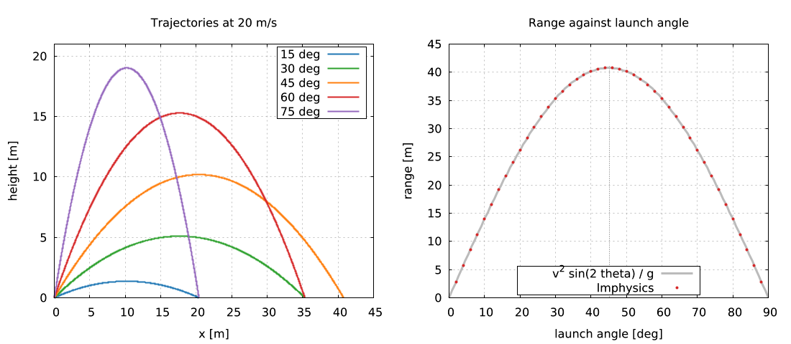 |
| --- | --- |
| A baseball hit at 45 m/s: air drag cuts 206 m to 111 m and the best angle to 40 degrees.<br>`lmctl https://raw.githubusercontent.com/lmctl-ai/lmphysics/main/examples/projectile_drag.lms` | Projectile range against launch angle in vacuum: 44 simulations, 45 degrees wins.<br>`lmctl https://raw.githubusercontent.com/lmctl-ai/lmphysics/main/examples/viz_projectile.lms` |


Every picture is made by the script named under it: it runs the simulation with lmphysics, draws with [lmplot](https://github.com/lmctl-ai/lmplot), [lmdraw](https://github.com/lmctl-ai/lmdraw), [lmcad](https://github.com/lmctl-ai/lmcad) or [lmblender](https://github.com/lmctl-ai/lmblender) and writes `images/` into the current directory. `examples/render-all.sh` regenerates `docs/images/`. The Cycles renders pass recorded positions and quaternions through the [portable CSV-to-OBJ pose bridge](examples/bridge/README.md) (boxes, spheres, cylinders) to [lmblender](https://github.com/lmctl-ai/lmblender).

**Quick start:** `npm i -g @lmctl-ai/lmctl`, then paste any `lmctl autorun` line above into a terminal; it downloads lmphysics and the drawing host and writes the picture to `images/`. The gear train, Cardan joint, quarter-car, damper sweep and baseball-drag pictures use API added in v0.1.2 (`gear`, `universal`, linear motors, `spring_at`, `Body.drag`).
Linux downloads require **dynamic glibc >= 2.35** (Ubuntu 22.04 or newer).

It is a scripting host, not a command-line tool: write an [lmscript](https://lmctl.com/tools/lmscript/skill.html) `_dsl_` block and run it. No Python, data files or third-party shared libraries are needed. Linux uses dynamic glibc >= 2.35.

```
# pendulum.lms
p = _lmcode_ cli="lmphysics" install="github:lmctl-ai/lmphysics@latest";
let s = phys.system("nsc");
s.integrator("hht").timestep(0.0005);
let pin = s.ground("pin");
let bob = s.sphere("bob", 0.05, 2000.0).pos(0.866, 0.0, -0.5);       # released at 60 degrees
let hinge = s.revolute("hinge", pin, bob, 0.0, 0.0, 0.0, 0.0, 1.0, 0.0);
s.record("bob", "x,z,vx,vz").record("hinge", "angle,fx,fz");
let e0 = s.energy();
s.run(5.0);
phys.assert_close(s.energy() / e0, 1.0, 0.0001);                     # energy is conserved
s.save_csv("pendulum.csv");
end _lmcode_
savedsl(p, "pendulum.dslb");
system ${dsl_cli(p)} --lmcode pendulum.dslb;
```

`lmscript pendulum.lms` finds `lmphysics` on `PATH` or downloads the release binary for your
platform on first use, compiles against the schema built into it, and runs the program.

## What it does

The world is a `System` (`phys.system("nsc")` for non-smooth contact with complementarity, or
`"smc"` for penalty contact). It owns named `Body` and `Joint` objects created by chained
builder calls; the DSL has no lists or closures, so time functions are expression strings in `t`
(`"2.5"`, `"0.5*sin(3*t)"`) and results leave as a CSV. The world is right-handed with
gravity `(0, 0, -9.81)` by default; lengths in m, masses in kg, angles in rad.

| `phys.` | |
| --- | --- |
| `system("nsc"\|"smc")` | new world |
| `assert_close(a, b, tol)` `print(text)` `version()` | checks and output |

| `System.` | |
| --- | --- |
| `gravity(x,y,z)` `timestep(dt)` `integrator(name)` `solver(name, iters)` `newton(iters, rtol, atol)` `hht_alpha(a)` | numerics |
| `material(name, friction, restitution)` `stiffness(name, young, poisson)` | contact materials (`"default"` always exists) |
| `ground(name)` `box(name, sx,sy,sz, density)` `sphere(name, r, density)` `cylinder(name, r, h, density)` `floor(name, material)` | bodies (cylinder axis is local y; `floor` is a fixed collision slab with its top at z = 0) |
| `revolute` `prismatic` `cylindrical`¹ (`name, A, B, px,py,pz, ax,ay,az`) `lock` `spherical` (`name, A, B, px,py,pz`) `distance` (`name, A, B, ax,ay,az, bx,by,bz`) | joints between bodies A and B; points and axes in world coordinates at creation |
| `universal(name, A, B, px,py,pz, ax,ay,az, bx,by,bz)`¹ | Cardan joint: cross axis a fixed in A, b fixed in B (perpendicular) |
| `gear(name, A, B, ratio, ax,ay,az)`¹ | spur gear pair on shafts through the body centres: B turns at -ratio times A (ratio = radius A / radius B); each gear keeps its own revolute or motor |
| `spring(name, A, B, k, c, rest)` `spring_at(name, A, B, ax,ay,az, bx,by,bz, k, c, rest)`¹ | linear spring-damper between the body centres, or between two body-fixed points |
| `motor_speed(name, A, B, px,py,pz, ax,ay,az, "expr(t)")` `motor_angle(...)` `motor_torque(...)`¹ | rotational motor: speed, angle or torque given as an expression |
| `motor_position(...)`¹ `motor_linear_speed(...)`¹ `motor_force(...)`¹ (same arguments) | linear motor: B slides along the axis relative to A |
| `record(name, "col,col")` `step()` `run(t_end)` `save_csv(path)` | fixed-step integration and logging (one CSV row per step) |
| `record_every(n)` | keep every n-th step (the last state is always written) |
| `collision_margins(envelope, margin)` | NSC only: `(0, 0)` makes restitution exact (apex = e^2 h) but stacks unstable; default is Chrono's 3 cm / 1 cm |
| `bounce_speed(v)` | NSC: below this approach speed (default 0.15 m/s) restitution is ignored |
| `time()` `energy()` `contacts()` | state queries |

`Body`: `pos(x,y,z)` `vel(x,y,z)` `rot_axis(ax,ay,az,angle)` `omega(x,y,z)` `fixed(bool)`
`mass_props(m, ixx,iyy,izz)` `collide(material)`, `force("fx(t)","fy(t)","fz(t)")` and `torque(...)` (world-frame loads as expressions in t), `drag(c1, c2)`¹ (air drag F = -(c1 + c2 |v|) v), and readers `mass x y z vx vy vz wx wy wz lx ly lz speed ke`
(`l*` is angular momentum about the centre, world frame; `ke` kinetic energy).
`Joint`: `angle` (rotation of B about the joint axis since creation, unwrapped) `travel`¹ (slide of B along the axis) `length` `force`
(spring force, negative in tension, otherwise reaction magnitude) `torque` `effort`¹ (signed motor torque or force) and `reaction_x/y/z` (force on B, world frame).

¹ New in v0.1.2 (in `main`, not yet in a release; `@latest` gets it once v0.1.2 is tagged).
Recorded body poses also include `qw qx qy qz` (Hamilton quaternions, scalar first). Record columns are the same names, joints also `fx fy fz tx ty tz`. Schema and rules:
[durable-memory/03-schema-v0.md](durable-memory/03-schema-v0.md).

### Choosing numerics

| need | use |
| --- | --- |
| contact (NSC) | default `integrator("euler")` and PSOR; `solver("apgd", 200)` for stacks |
| smooth mechanisms, energy conservation | `integrator("hht")` (direct solver, Newton budget preset) |
| constant accelerations, springs without joints | `integrator("trapezoidal")` (exact for constant forces) |
| mechanisms with redundant constraints (planar linkage built from 3D joints) | `integrator("trapezoidal")` with PSOR |

Measured accuracies are listed in [durable-memory/05-build-run-test.md](durable-memory/05-build-run-test.md).

### Limits worth knowing

- Chrono's NSC contact (cone complementarity) keeps a sliding body `mu |v| dt` above the floor; a block that
  starts exactly in contact with a speed hops once on the first step. Start it a few millimetres above the floor
  (see [viz_friction_stop.lms](examples/viz_friction_stop.lms)) or use a smaller step.
- Restitution with Chrono's default 3 cm collision envelope lands between e^2 and e: use `collision_margins(0, 0)`
  for isolated impacts. Stacks of boxes need the defaults.
- `hht`/`newmark` fail on over-constrained mechanisms (planar linkages built from 3D joints): use `trapezoidal`.
  HHT does not work with NSC contact.
- Balance problems need small collision margins: with Chrono's default 3 cm envelope and 1 cm margin a box resting on an
  edge with its centre of mass 2 cm past it does not tip. `collision_margins(0.002, 0.001)` puts the tipping point within
  a millimetre (see [harmonic_overhang.lms](examples/harmonic_overhang.lms)); stacks that settle under load still prefer the defaults.
- Bullet's cylinder contact rolls a few percent off the closed form (2-5% for a disc on a ramp, solver dependent); the
  sphere contact is exact. [rolling_race.lms](examples/rolling_race.lms) rolls spheres with cylinder or hoop inertia.
- `Body.drag` is evaluated from the state at the start of each step (explicit), so its error is O(dt).
- Rigid bodies, joints and contact only: no meshes, no soft bodies, no vehicles, no fluids.
- Results differ in the last digits between platforms; the tests compare with tolerances.

## Build

C++17 compiler, CMake 3.24, git; nothing else.

```sh
scripts/sync-deps.sh            # Eigen and Chrono at the commits in deps.lock (Chrono: sparse partial clone of src/, ~50 MB)
cmake -S . -B build && cmake --build build
./test.sh                       # needs lmscript on PATH
```

Linux uses dynamic glibc >= 2.35, with Chrono, Bullet, Eigen and GCC C++ runtimes static.
macOS links only system libraries; Windows links the MinGW runtime statically. `lmphysics --notices` prints the license texts of everything inside.

`lmphysics --version` remains exactly `lmphysics X.Y.Z` for installer compatibility.
The Linux runtime baseline applies to x64 and ARM64; no relink-object archive
or third-party shared libraries are required.

## Resource limits

A program may use at most 4096 MiB in total (bodies, joints, recorded steps, Chrono and Bullet state,
everything the host keeps); beyond that it stops with a run error (exit 3) naming the limit, instead
of exhausting the machine. Set `LMPHYSICS_MAX_MEMORY_MB` to change it, e.g.
`LMPHYSICS_MAX_MEMORY_MB=16384 lmscript long_run.lms`. Every recorded row costs 8 bytes per column (`record_every(n)` keeps every n-th step).

## License

MIT ([LICENSE](LICENSE)). Project Chrono is BSD-3-Clause, its bundled Bullet collision code is zlib,
Eigen is MPL-2.0 (used with `EIGEN_MPL2_ONLY`, unmodified); see [THIRD_PARTY_NOTICES](THIRD_PARTY_NOTICES).
